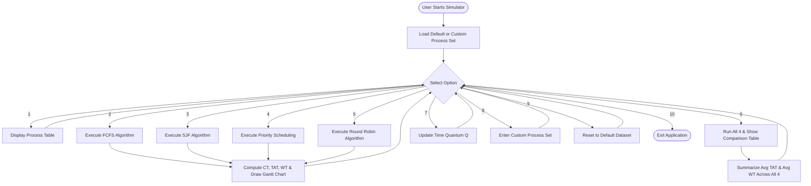

# ACADEMIC PROJECT REPORT

## TOPIC: CPU PROCESS SCHEDULING SIMULATOR
**Course:** Operating Systems (OS)  
**Academic Year:** 2nd Year B.Tech / B.E. (Computer Science & Engineering)  

---

### **Submitted By:**
- **Student Name:** Rishi Pandey  
- **ERP Number:** 25ET2041025  
- **Department:** Department of Computer Science & Engineering  
- **Institution:** Alard University, Pune  

---

<br>

## CERTIFICATE OF COMPLETION

This is to certify that the project entitled **"CPU Process Scheduling Simulator"** is a bona fide work carried out by **Rishi Pandey (ERP No: 25ET2041025)**, a student of 2nd Year Computer Science & Engineering at **Alard University, Pune**, in partial fulfillment of the requirements for the Operating Systems Laboratory curriculum.

<br>

**Signature of Student:** ______________________  
**Date:** 25th October 2026  

**Signature of Guide / Faculty Examiner:** ______________________  
**Department Seal:**  

---

## ACKNOWLEDGEMENT

I would like to express my sincere gratitude to my faculty mentors and the Department of Computer Science & Engineering at **Alard University, Pune**, for their continuous support, guidance, and academic facilities during the development of this Operating Systems mini project.

I am immensely thankful to my subject professors for imparting fundamental concepts of process management, scheduling policies, and operating system design principles. I also thank my classmates for their collaborative discussions and valuable feedback during testing.

**Rishi Pandey**  
ERP No: 25ET2041025  
Department of CSE, Alard University Pune  

---

## TABLE OF CONTENTS
1. [Abstract](#1-abstract)
2. [Introduction & Problem Statement](#2-introduction--problem-statement)
3. [Theoretical Foundations of CPU Scheduling](#3-theoretical-foundations-of-cpu-scheduling)
4. [Algorithms Detailed Specification](#4-algorithms-detailed-specification)
5. [Mathematical Formulas](#5-mathematical-formulas)
6. [System Architecture & Flowchart](#6-system-architecture--flowchart)
7. [Implementation & Code Structure](#7-implementation--code-structure)
8. [Experimental Results & Gantt Charts](#8-experimental-results--gantt-charts)
9. [Comparative Evaluation & Trade-Off Analysis](#9-comparative-evaluation--trade-off-analysis)
10. [Conclusion & Future Work](#10-conclusion--future-work)
11. [References](#11-references)

---

## 1. ABSTRACT

CPU scheduling is the fundamental mechanism through which modern multiprogramming operating systems allocate finite processor resources among competing ready processes to optimize system performance. Understanding and evaluating different CPU scheduling algorithms analytically can be challenging without concrete visualization.

This project implements a **CPU Process Scheduling Simulator** written in C++ (C++17) covering four classical scheduling policies:
1. **First-Come, First-Served (FCFS)** (Non-preemptive)
2. **Shortest Job First (SJF)** (Non-preemptive)
3. **Priority Scheduling** (Non-preemptive)
4. **Round Robin (RR)** (Preemptive, with configurable time quantum)

The simulator generates **ASCII Gantt Charts**, calculates key scheduling metrics (**Completion Time, Turnaround Time, and Waiting Time**), and produces an automated **side-by-side comparative benchmark** identifying the most efficient algorithm for any given process workload.

---

## 2. INTRODUCTION & PROBLEM STATEMENT

### 2.1 Introduction
In modern computers, multiple active processes reside in main memory awaiting execution. Because the CPU can execute only one process at a time (per core), the short-term scheduler (or CPU scheduler) must select one process from the ready queue whenever the processor becomes idle.

### 2.2 Problem Statement
Different scheduling algorithms optimize for different goals:
- Batch systems prioritize throughput and turnaround time.
- Interactive and time-sharing systems prioritize low response time and fairness.

Without an interactive simulation platform, students and engineers cannot directly observe how variations in arrival times, burst times, priorities, and quantum slices affect average waiting times and cause pathological behaviors such as the **Convoy Effect** or **Starvation**.

### 2.3 Objectives
1. Implement non-preemptive and preemptive scheduling algorithms accurately.
2. Render clear ASCII Gantt Charts visualizing process timelines and idle CPU intervals.
3. Automatically compute Completion Time ($CT$), Turnaround Time ($TAT$), and Waiting Time ($WT$).
4. Provide a comparative analytics feature to compare all 4 algorithms on identical process workloads.
5. Offer both preloaded default datasets for instant academic evaluation and custom dataset input capabilities.

---

## 3. THEORETICAL FOUNDATIONS OF CPU SCHEDULING

### 3.1 Scheduling Criteria
- **CPU Utilization:** Keeping the CPU as busy as possible ($40\% - 90\%$).
- **Throughput:** Number of processes completed per unit time.
- **Turnaround Time ($TAT$):** The total time elapsed between process submission and its completion.
- **Waiting Time ($WT$):** The total duration spent by a process in the ready queue waiting for CPU allocation.
- **Response Time ($RT$):** Time elapsed from process submission to the first CPU response.

---

## 4. ALGORITHMS DETAILED SPECIFICATION

### 4.1 First-Come, First-Served (FCFS)
- **Type:** Non-preemptive.
- **Concept:** The process that requests the CPU first is allocated the CPU first using a FIFO queue.
- **Characteristics:** Easy to implement, but vulnerable to the **Convoy Effect**, where short processes queue behind a CPU-heavy process, drastically inflating average waiting times.

### 4.2 Shortest Job First (SJF - Non-Preemptive)
- **Type:** Non-preemptive.
- **Concept:** When the CPU is free, the ready process with the smallest CPU burst time is scheduled next.
- **Characteristics:** Mathematically optimal for minimizing average waiting time. However, it can lead to starvation for long processes if shorter jobs continually arrive.

### 4.3 Priority Scheduling (Non-Preemptive)
- **Type:** Non-preemptive.
- **Concept:** Each process is assigned an integer priority value. The CPU is allocated to the highest-priority ready process (in this project, lower numeric value represents higher priority).
- **Characteristics:** Reflects business importance or urgency. Can suffer from indefinite blocking (starvation), typically resolved in real OSs via *aging*.

### 4.4 Round Robin (RR)
- **Type:** Preemptive.
- **Concept:** Designed specifically for time-sharing systems. The CPU is allocated for a fixed time quantum ($Q$). If the process has not completed by the end of $Q$, it is preempted and returned to the tail of the ready queue.
- **Characteristics:** Eliminates starvation and ensures equitable CPU distribution. Performance depends heavily on the chosen time quantum $Q$.

---

## 5. MATHEMATICAL FORMULAS

For any process $P_i$ with Arrival Time ($AT_i$), Burst Time ($BT_i$), and Completion Time ($CT_i$):

1. **Turnaround Time ($TAT$):**
   $$TAT_i = CT_i - AT_i$$

2. **Waiting Time ($WT$):**
   $$WT_i = TAT_i - BT_i$$

3. **Average Turnaround Time ($Avg\_TAT$):**
   $$Avg\_TAT = \frac{1}{N} \sum_{i=1}^{N} TAT_i$$

4. **Average Waiting Time ($Avg\_WT$):**
   $$Avg\_WT = \frac{1}{N} \sum_{i=1}^{N} WT_i$$

---

## 6. SYSTEM ARCHITECTURE & FLOWCHART



---

## 7. IMPLEMENTATION & CODE STRUCTURE

The simulator is implemented in standard C++ (`main.cpp`) utilizing modular object-oriented paradigms and the C++ Standard Template Library (`std::vector`, `std::queue`, `std::sort`):

- `struct Process`: Stores process parameters (`pid`, `arrivalTime`, `burstTime`, `priority`) along with computed metrics (`completionTime`, `turnaroundTime`, `waitingTime`, `remainingTime`).
- `struct GanttSlot`: Encapsulates start time, end time, and process identifier for Gantt chart generation.
- `runFCFS()`, `runSJF()`, `runPriority()`, `runRoundRobin()`: Standalone scheduling policy engines returning execution statistics.
- `printGanttChart()`: Generates ASCII Gantt timeline blocks with execution ticks.
- `printMetricsTable()`: Formats results into structured alignment with 2 decimal precision.

---

## 8. EXPERIMENTAL RESULTS & GANTT CHARTS

### 8.1 Test Dataset
The default benchmark dataset consists of 5 processes:
| Process ID | Arrival Time ($AT$) | Burst Time ($BT$) | Priority (Lower = Higher) |
| :---: | :---: | :---: | :---: |
| **P1** | 0 ms | 5 ms | 2 |
| **P2** | 1 ms | 3 ms | 1 |
| **P3** | 2 ms | 8 ms | 4 |
| **P4** | 3 ms | 6 ms | 3 |
| **P5** | 4 ms | 4 ms | 2 |

---

### 8.2 Execution Results & Gantt Charts

#### A. First-Come, First-Served (FCFS)
```text
>>> ASCII GANTT CHART <<<
+-------+-------+-------+-------+-------+
|  P1   |  P2   |  P3   |  P4   |  P5   |
+-------+-------+-------+-------+-------+
0       5       8       16      22      26      

PID     Arrival (AT)  Burst (BT)  Priority  Completion(CT)  Turnaround(TAT) Waiting(WT)
P1      0             5           2         5               5               0
P2      1             3           1         8               7               4
P3      2             8           4         16              14              6
P4      3             6           3         22              19              13
P5      4             4           2         26              22              18

Average Turnaround Time (TAT): 13.40 ms
Average Waiting Time    (WT) : 8.20 ms
```

#### B. Shortest Job First (SJF - Non-Preemptive)
```text
>>> ASCII GANTT CHART <<<
+-------+-------+-------+-------+-------+
|  P1   |  P2   |  P5   |  P4   |  P3   |
+-------+-------+-------+-------+-------+
0       5       8       12      18      26      

Average Turnaround Time (TAT): 11.80 ms
Average Waiting Time    (WT) : 6.60 ms
```

#### C. Priority Scheduling (Non-Preemptive)
```text
>>> ASCII GANTT CHART <<<
+-------+-------+-------+-------+-------+
|  P1   |  P2   |  P5   |  P4   |  P3   |
+-------+-------+-------+-------+-------+
0       5       8       12      18      26      

Average Turnaround Time (TAT): 11.80 ms
Average Waiting Time    (WT) : 6.60 ms
```

#### D. Round Robin (Time Quantum = 2 ms)
```text
>>> ASCII GANTT CHART <<<
+-------+-------+-------+-------+-------+-------+-------+-------+-------+-------+-------+-------+-------+-------+
|  P1   |  P2   |  P3   |  P1   |  P4   |  P5   |  P2   |  P3   |  P1   |  P4   |  P5   |  P3   |  P4   |  P3   |
+-------+-------+-------+-------+-------+-------+-------+-------+-------+-------+-------+-------+-------+-------+
0       2       4       6       8       10      12      13      15      16      18      20      22      24      26      

Average Turnaround Time (TAT): 17.80 ms
Average Waiting Time    (WT) : 12.60 ms
```

---

## 9. COMPARATIVE EVALUATION & TRADE-OFF ANALYSIS

### 9.1 Overall Benchmark Comparison Summary
```text
====================================================================
                     OVERALL COMPARISON SUMMARY                     
====================================================================
Algorithm                   Avg Turnaround (ms)   Avg Waiting (ms)
--------------------------------------------------------------------
FCFS                        13.40                 8.20
SJF (Non-Preemptive)        11.80                 6.60
Priority Scheduling         11.80                 6.60
Round Robin (Q=2)           17.80                 12.60
====================================================================
Recommendation: SJF produces the lowest average waiting time (6.60 ms).
```

### 9.2 Key Findings
1. **SJF Efficiency:** Non-preemptive SJF achieved the lowest average waiting time ($6.60\text{ ms}$), demonstrating its mathematical optimality.
2. **Convoy Effect in FCFS:** FCFS forced process P5 (burst 4) to wait until time 22 simply because it arrived slightly after P3 and P4, causing high individual waiting times.
3. **Round Robin Trade-Off:** While Round Robin yielded a higher average waiting time ($12.60\text{ ms}$) due to frequent time quantum slicing, it provided the best responsiveness and interactive fairness with no process starved.

---

## 10. CONCLUSION & FUTURE WORK

### 10.1 Conclusion
The **CPU Process Scheduling Simulator** provides an accessible, educational, and accurate environment for studying process scheduling policies in operating systems. By implementing FCFS, SJF, Priority, and Round Robin alongside ASCII Gantt charts and automated comparative performance metrics, this project solidifies core 2nd-year CSE systems engineering principles.

### 10.2 Future Work
- **Multi-Level Feedback Queue (MLFQ):** Implement multi-queue scheduling with dynamic priority promotion and demotion.
- **Preemptive SJF (SRTF):** Add Shortest Remaining Time First simulation with runtime preemption.
- **Context Switch Overhead:** Model non-zero context switching time penalty ($\delta$).

---

## 11. REFERENCES
1. Silberschatz, A., Galvin, P. B., & Gagne, G. (2018). *Operating System Concepts* (10th ed.). Wiley.
2. Tanenbaum, A. S., & Bos, H. (2015). *Modern Operating Systems* (4th ed.). Pearson.
3. Stallings, W. (2018). *Operating Systems: Internals and Design Principles* (9th ed.). Pearson.
